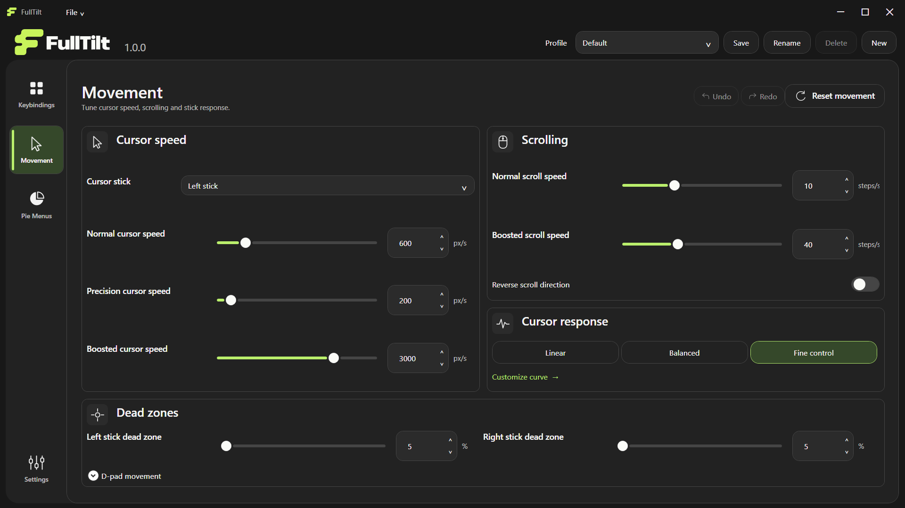
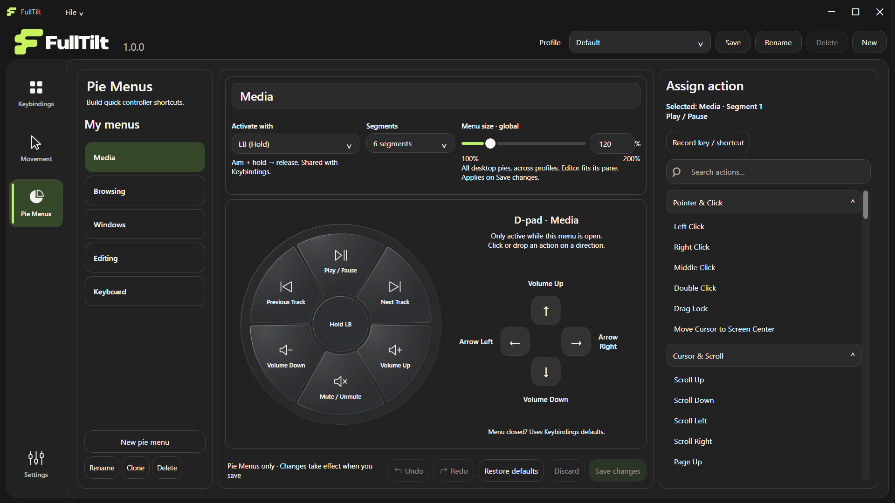

# FullTilt

**Your controller, your desktop.**

FullTilt is a free, open-source Windows application that lets you use a game controller as an alternative to a traditional mouse and keyboard. Whether you're navigating your PC from the couch or looking to reduce prolonged mouse use, FullTilt offers a different way to control your desktop.

## [Download Latest Version](https://github.com/adityabhanushali-arch/FullTilt/releases/latest)

Download **FullTilt-win-x64.zip** from the latest stable GitHub Release. The first public version is **1.0.0**. The link becomes available when that release is published; this repository was prepared and verified locally first.


## What FullTilt does

- Move the pointer and scroll with an XInput game controller.
- Click, drag, use keyboard shortcuts and customize controller bindings.
- Adjust normal, precision and boosted cursor speeds independently, plus scrolling, dead zones and response.
- Open directional pie menus with customizable segments and contextual D-pad actions.
- Use Windows navigation, window management, editing and media commands.
- Keep multiple profiles and portable settings, with Save/Discard and per-tab Undo/Redo for assignments.
- Use Dark, Light or system theme, configurable pause, tray controls and optional GitHub update checks.

Windows/application permissions, keyboard layouts and target-app behavior can affect synthetic input. FullTilt does not hide the controller from games or other software.

## Requirements

- **Windows 11 x64** (build 22000 or later).
- An **XInput-compatible controller**, such as an Xbox-compatible gamepad. Other controller APIs require an external XInput mapping tool; FullTilt does not bundle one.
- A writable application folder and temporary directory. No installer, administrator access, account or separately installed .NET runtime is required for the portable ZIP.
- Internet access only for GitHub update checks and external links. Controller navigation works offline.

## Install and start

1. Download the portable **FullTilt-win-x64.zip**, rather than GitHub's source-code ZIP.
2. Extract the complete folder to a writable location. Do not run from inside the ZIP.
3. Connect your controller and run **FullTilt.exe**.
4. Center the sticks and release controller buttons before input arms. Open Keybindings, Movement, Pie Menus or Settings to adjust the setup.

The unsigned executable may show a Windows reputation prompt. The included .NET runtime extracts native files under the current user's temporary directory, which must be writable. You can start with `FullTilt.exe --paused` to begin with controller output paused.

### Current default setup

| Control | Default behavior |
| --- | --- |
| Left / right stick | Cursor / scrolling |
| A / X / Y | Left / right / middle mouse hold |
| B | Recorded Caps Lock, held until release |
| D-pad | Arrow keys |
| LT | Speed Boost while held |
| LB / RB | Media / Editing pie menu |
| L3 / R3 | Windows pie menu |
| RT | Keyboard pie menu |
| D-pad Up + B + Y | Hold together to pause or resume |

These defaults capture the creator-approved saved Default profile from 2026-11-01: normal **600 px/s**, precision **200 px/s**, boosted **3000 px/s**, scrolling **10/40 steps/s**, dead zones **5%**, response **260%**, and desktop pie size **120%**. Five menus are included, including Browsing, which can be assigned to another control. The keyboard pie includes Enter, Backspace and Space D-pad overrides. Existing installations keep their saved configuration.

Movement and Settings apply/save immediately. Keybindings and Pie Menus remain drafts until **Save changes**. **Discard**, Undo and Redo let you review edits; switching profiles or closing resolves drafts with Save/Discard/Cancel. New pie menus start with four empty segments. Menu size is global across desktop pies and profiles; the editor preview fits its own pane independently.

Hold a pie's activation button, point the cursor-role stick at a segment, then release the same button to execute. Keep the stick centered briefly before releasing to cancel. Configured D-pad actions work while that pie is open. Pause, disconnect and Release held inputs release FullTilt-owned input and require neutral rearming.

### Pause and exit

Use the configurable pause shortcut or **Settings → Pause** to suspend controller output. **Release held inputs** clears owned keys, mouse buttons and active modes. Closing the settings window keeps FullTilt running in the tray. **File → Exit FullTilt** or tray **Exit** stops the application completely after resolving pending edits.

## Profiles, updates and rollback

All controller profiles, keybindings, pie menus and settings live in **Profiles/settings.json** beside FullTilt.exe. Theme, window mode and update preferences live in **Profiles/app-preferences.json**. Copy the entire Profiles folder when moving FullTilt. Startup registration is opt-in and belongs to your Windows account; re-enable it from a new location if you move the executable.

To update: exit FullTilt, back up your current folder, then extract the new application files over it. **Keep your Profiles folder.** Release ZIPs contain no personal Profiles, so replacing the application files leaves them intact. If using a new directory, copy Profiles there **before first launch**. Retain a separate old folder for rollback. Do not run two versions against the same settings file.

**File → Check for Updates** checks the public GitHub latest stable release and shows release notes and a specific release-page link. Automatic checks run asynchronously on startup and roughly every six hours; disable or re-enable them in the update dialog. A dismissed version does not repeatedly notify automatically; manual checks always work. Offline/rate-limit/errors are distinguished from being up to date, and automatic failures stay quiet. Updates remain manual: FullTilt does not download or replace its running executable and requires no GitHub token.

**Development build migration:** the former “4.8” development build has numeric version **1.4.8**, which compares newer than public **1.0.0**. Development users must manually install this first public version and copy Profiles before starting it. Public 1.0.0 then detects future public versions such as 1.1.0 normally. The profile schema remains 17; executable version changes do not reset saved settings.

## Windows Controller Navigation Conflict

Some Windows 11 systems use built-in controller navigation in Start, notification panels and other system interfaces, which can conflict with FullTilt's cursor controls. The download includes an optional **FullTilt-Controller-Navigation-Fix** folder. Use it only if you experience this issue.

The utility requires administrator privileges and changes one machine-wide Windows registry setting. Its PowerShell entry points preserve the original value/type or absence and provide accurate restoration. It never runs automatically and is not required to install or use FullTilt. See [application and restoration instructions](FullTilt-Controller-Navigation-Fix/README.md). Windows-build behavior varies.


## More application views




These are renders of the actual WPF application using the approved bundled defaults and an isolated, non-emulating model. They are not hardware-test evidence.

## Build, test and release

Contributors need **Windows**, **PowerShell 7**, **Git** and **.NET SDK 10.0.401** (later patches in that feature band are accepted by global.json). FullTilt uses C#/.NET 10, WPF and Windows XInput, with no third-party NuGet package dependencies. NuGet access may be needed for Microsoft runtime packs and vulnerability checks.

```powershell
./scripts/build.ps1
./scripts/publish.ps1 -SkipBuild
./scripts/verify-package.ps1
./scripts/release.ps1 -PackageOnly
```

Or run `./scripts/release.ps1` for the full local process once. It builds/tests, publishes a self-contained untrimmed Windows x64 executable, runs isolated package diagnostics, packages **FullTilt-win-x64.zip**, generates SHA-256 checksums/release notes and verifies the extracted portable runtime and settings replacement. Outputs go to `Finals/FullTilt-vVERSION-win-x64` and `artifacts/github-release/vVERSION/`. Each replaced package is snapshotted under artifacts; Profiles are retained. No local script creates or pushes tags or publishes a GitHub release by default.

GitHub Actions checks pushes/PRs without release permissions. Only an explicitly approved matching stable tag, such as `v1.0.0`, starts the separate release workflow. It verifies the package, creates a draft, attaches complete assets and then publishes. See [release preparation and approval steps](docs/RELEASING.md) and [contribution guidelines](CONTRIBUTING.md).

Version metadata lives in src/FullTilt/FullTilt.csproj. Header, About, Settings and numeric update comparison use that same version. Repository/portfolio links live in src/FullTilt/Assets/LaunchLinks.json. Runtime data, local credentials, build outputs and archives stay ignored and excluded from public packages. Automated checks use fake inputs and isolated settings; physical controller, focus, GPU blur and display transitions require manual validation.

## Report a problem or contribute

Use [GitHub Issues](https://github.com/adityabhanushali-arch/FullTilt/issues) or **File → Report a Problem**. Include your FullTilt/Windows versions, controller type and reproduction steps. Remove personal data from screenshots and logs. Contributions are welcome under the [MIT License](LICENSE); read [CONTRIBUTING.md](CONTRIBUTING.md) first.

## Creator and license

Created by **Aditya Bhanushali**.

[LinkedIn](https://www.linkedin.com/in/adityabhanushali/) · [Behance showreel](https://www.behance.net/gallery/253243865/Motion-Design-Showreel)

FullTilt's code, logo and controller illustration are distributed under the [MIT License](LICENSE). Microsoft runtime components retain their own licenses/notices, included with the portable build; see [THIRD-PARTY-NOTICES.md](THIRD-PARTY-NOTICES.md). FullTilt has no affiliation with controller manufacturers.
