<div align="center">

<picture>
  <source media="(prefers-color-scheme: dark)" srcset="docs/media/logo-dark.svg">
  
</picture>

## A better way to control your desktop.

Turn your game controller into a fully functional mouse and keyboard for Windows.<br>
Move your cursor, click, scroll and navigate your desktop, all without reaching for a mouse.

[](https://github.com/AadityaBhanushali/FullTilt/releases/latest)
[](https://github.com/AadityaBhanushali/FullTilt/actions/workflows/build.yml)
[](LICENSE)


**[⬇ Download for Windows](https://github.com/AadityaBhanushali/FullTilt/releases/latest)** &nbsp;·&nbsp; [How to install](#get-started) &nbsp;·&nbsp; [User guide](docs/USER-GUIDE.md)

<sub>Download, double-click Step 1, open FullTilt. <a href="#get-started">That's it</a>.</sub>

<br>

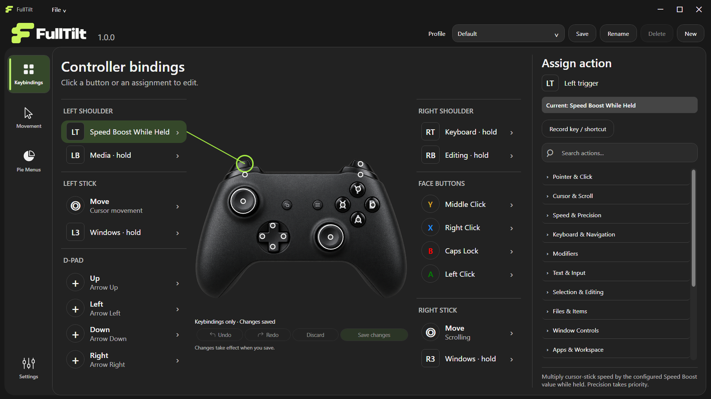

</div>

## What is FullTilt?

FullTilt gives you a different, more convenient way to use Windows with a game controller.

Whether you're gaming, relaxing on the couch or using your PC from a distance, FullTilt lets you control your entire desktop without switching between your controller, mouse and keyboard.

It's also an alternative for people who find a traditional mouse uncomfortable or difficult to use, including those with repetitive strain injuries (RSI). Customizable controls, adjustable sensitivity and precision movement let you navigate your desktop in a way that works better for you.

No installer, account or setup wizard: download, unzip and run.

<table>
<tr>
<td width="50%" valign="top">

### 🎮 Made for gaming and couch navigation

Stay on your controller even when you're outside a game. Browse the web, manage windows, control media and get around Windows comfortably from your couch. Customizable shortcuts and radial **pie menus** keep everyday actions within easy reach.

</td>
<td width="50%" valign="top">

### 🖱️ An alternative to the traditional mouse

If holding or using a mouse for long periods is uncomfortable, FullTilt offers another way to control your cursor. Adjust movement speed, fine-tune **Precision** mode and customize button assignments to suit your comfort.

</td>
</tr>
</table>

## Get started

**[Download `FullTilt-win-x64.zip`](https://github.com/AadityaBhanushali/FullTilt/releases/latest)** and extract it (right-click → **Extract All**). Then:

**Step 1:** open the `Step-1-Windows-Controller-Fix` folder, double-click **`Disable_Windows_Controller_UI_Navigation.reg`** and choose **Yes**.
To undo it any time, double-click **`Restore_Windows_Default_Controller_Navigation.reg`** in the same folder.

**Step 2:** open **`FullTilt.exe`**.

> [!TIP]
> You can open FullTilt and try it before Step 1. The fix just turns off Windows' own controller navigation (in Start, Quick Settings and notifications) so it doesn't get in FullTilt's way. It makes the experience smoother.

Windows may warn you about `FullTilt.exe` because it isn't code-signed yet: choose **More info → Run anyway**.

## What you can do with FullTilt

### 1. Create and customize pie menus

Pie menus put a group of actions one flick away. Hold the button assigned to a menu, point the stick at an action and release to run it. FullTilt comes with menus for Windows, editing, browsing, media and keyboard actions. You can change any of them or build your own, with two to eight segments each.

<p align="center">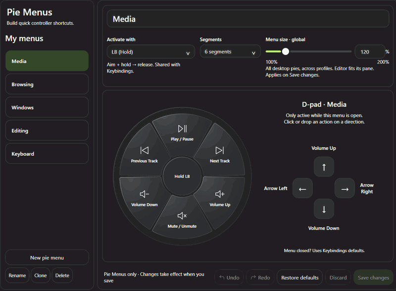</p>

### 2. Adjust cursor speed and precision

A joystick has two jobs as a mouse: crossing the screen quickly and landing on small targets. One speed setting can't do both well. FullTilt uses three speeds that work together:

- **Normal** for everyday movement.
- **Speed Boost** for crossing the screen fast while a button is held (LT by default).
- **Precision** for slowing down on small buttons, links and text. Assign it to any button.

Dead zones ignore small amounts of stick drift, and the response curve sets how quickly the cursor speeds up as you push the stick further. Changes apply immediately.

<p align="center">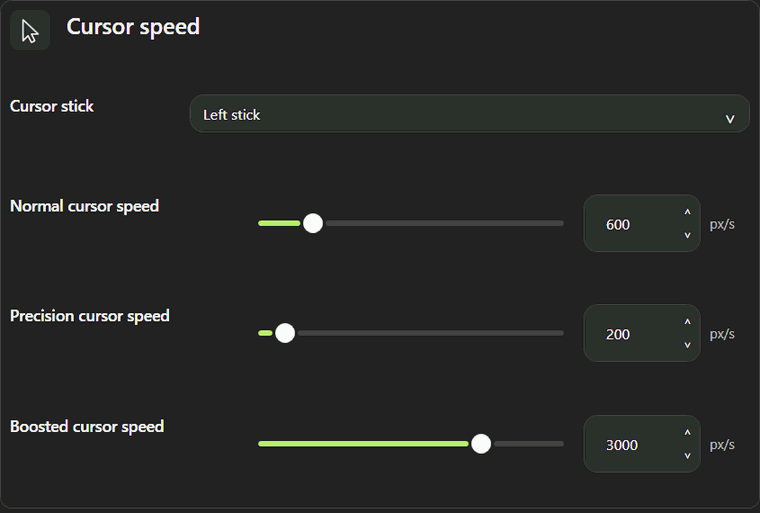</p>

### 3. Customize controller button assignments

Every button, trigger and D-pad direction can be remapped. Choose from mouse clicks, keyboard keys and Windows actions such as Task View or Show Desktop, or record your own keyboard shortcut. Changes stay as a draft until you select **Save changes**, and Undo, Redo and Discard are always available.

<p align="center">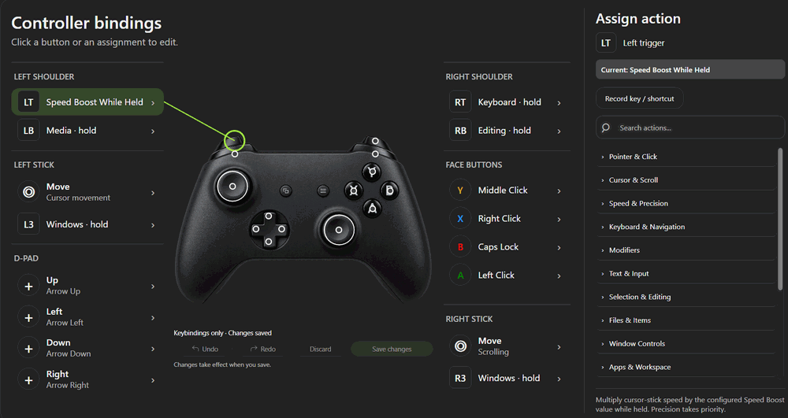</p>

### 4. Assign different D-pad controls to each pie menu

While a pie menu is open, the D-pad can do something specific to that menu. The Media menu uses it for volume, and the Browsing menu uses it for zooming and moving between tabs. When the menu closes, the D-pad goes back to its usual assignments, so these extra controls never replace your main layout.

<p align="center">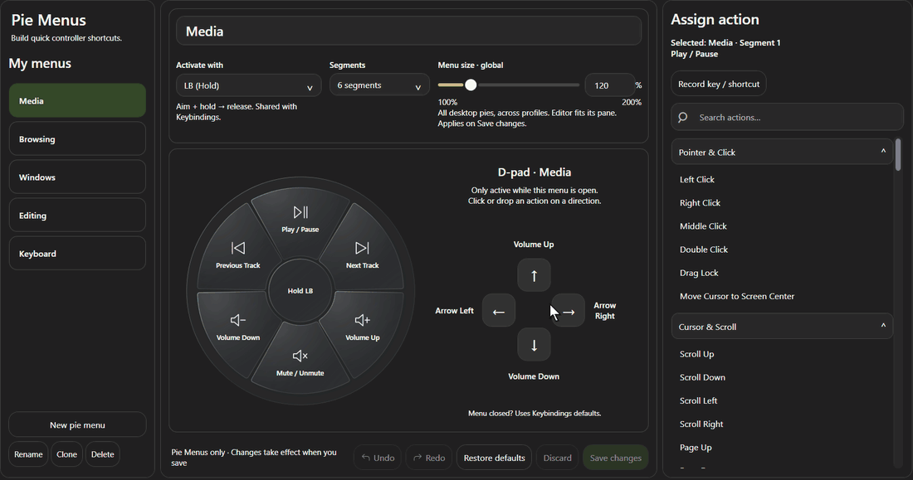</p>

### 5. Save and switch between profiles

A profile stores a complete setup: button assignments, pie menus and movement settings. Create separate profiles for gaming, browsing or general desktop use, and switch between them from the profile menu at the top of the window.

<p align="center">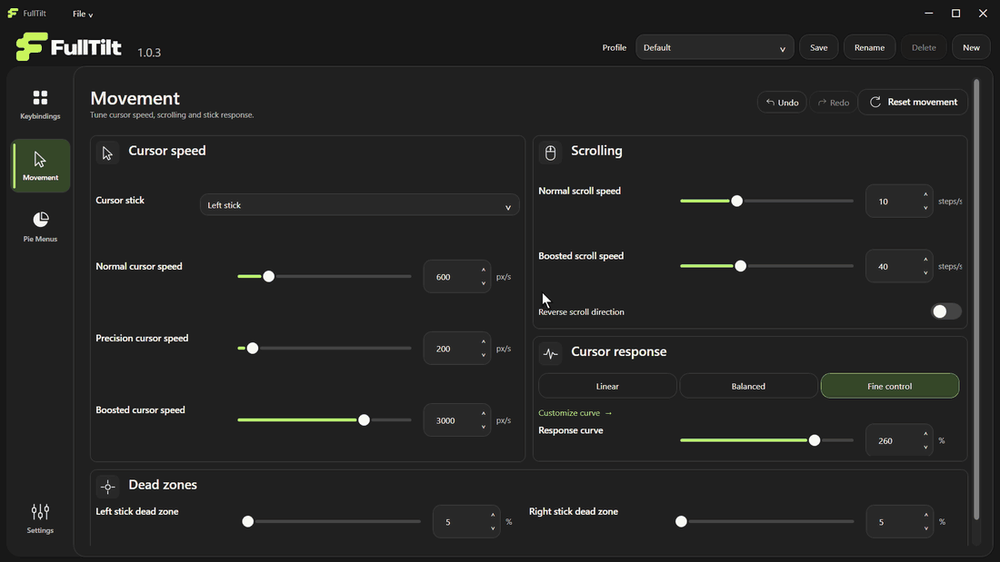</p>

<sub>Animations are recorded from the FullTilt app window, with the pointer added so each click is easy to follow.</sub>

## Features

| | |
| --- | --- |
| **Pointer & scrolling** | Cursor on either stick, separate **normal / precision / boosted** speeds, independent scroll speeds, reverse scroll, adjustable dead zones and a response curve (Linear, Balanced, Fine control or custom). |
| **100+ built-in actions** | Mouse buttons and drag lock, arrow and page keys, modifiers, copy/paste/undo, window snap and maximize, task view, virtual desktops, browser tabs, media keys, screenshots, apps and more. |
| **Record any shortcut** | Press a real key combination to bind it to a button, pie segment or D-pad direction. |
| **Pie menus** | Build as many menus as you like, each with 2 to 8 segments, its own D-pad overrides and a controller button of your choice to open it. One global size setting scales them all. |
| **Profiles** | Save and switch whole configurations. Settings are portable: they live in a `Profiles` folder next to `FullTilt.exe`. |
| **Safe by design** | A pause shortcut (default: **D-pad Up + B + Y**), a **Release held inputs** panic button, and neutral-stick re-arming after pauses or disconnects so nothing gets stuck. |
| **Windows controller fix** | Two double-click files in the download turn Windows' own controller navigation off so it stops competing with FullTilt, and back on whenever you want. |
| **Touch keyboard** | Show and hide the Windows touch keyboard from a controller button. |
| **Quiet in the tray** | Closing the window keeps FullTilt running in the tray; an optional on-screen indicator shows when it is paused. |
| **Updates you control** | Optional GitHub release checks. FullTilt never downloads or replaces itself. |

<table>
<tr>
<td width="50%">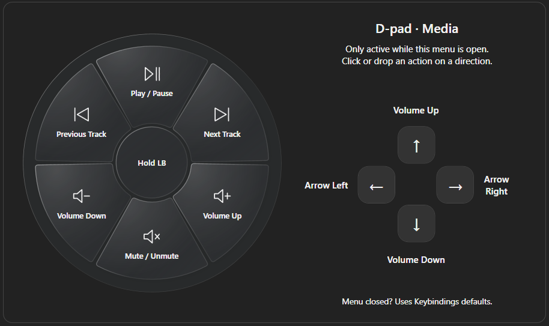</td>
<td width="50%">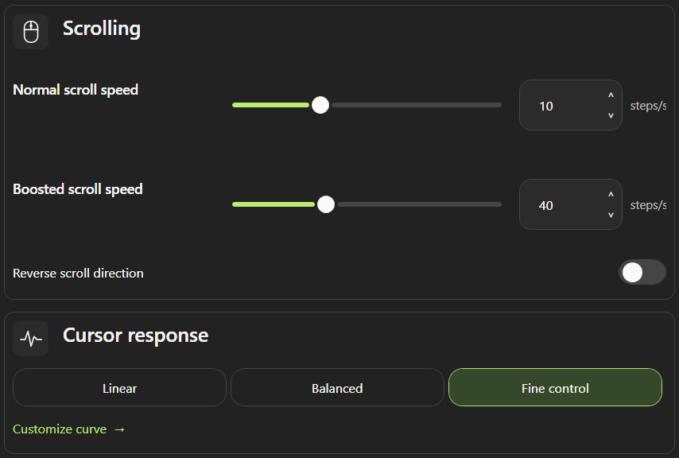</td>
</tr>
<tr>
<td align="center"><sub>Pie menus with per-menu D-pad actions</sub></td>
<td align="center"><sub>Scrolling and cursor response</sub></td>
</tr>
<tr>
<td width="50%">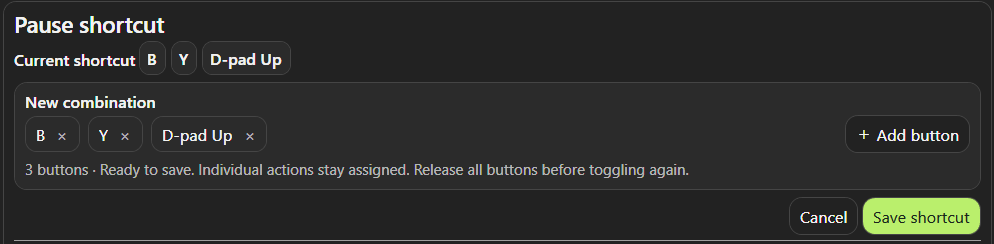</td>
<td width="50%">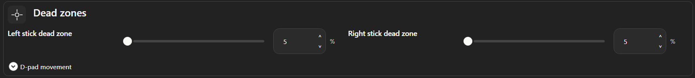</td>
</tr>
<tr>
<td align="center"><sub>A pause shortcut you can change</sub></td>
<td align="center"><sub>Stick dead zones</sub></td>
</tr>
</table>

<details>
<summary><b>Light theme</b></summary>
<br>
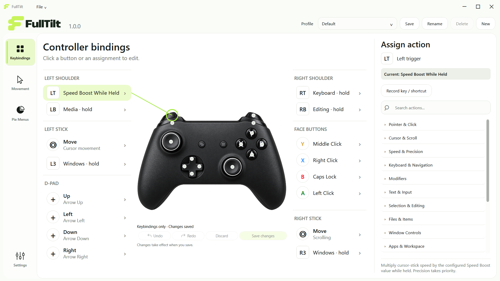
</details>

## Controls and requirements

### Default controls

| Control | Does |
| --- | --- |
| **Left stick** | Move the cursor |
| **Right stick** | Scroll |
| **A / X / Y** | Left / right / middle mouse button |
| **B** | Caps Lock (held while pressed) |
| **D-pad** | Arrow keys |
| **LT** (hold) | Speed Boost |
| **LB** (hold) | Media pie menu |
| **RB** (hold) | Editing pie menu |
| **L3 / R3** (hold) | Windows pie menu |
| **RT** (hold) | Keyboard pie menu |
| **D-pad Up + B + Y** | Pause / resume |

To use a pie menu, hold its button, point the cursor stick at a segment, then release. Release with the stick centered to cancel. Everything is remappable. See the **[user guide](docs/USER-GUIDE.md)** for profiles, updates and troubleshooting.

### Requirements

- Windows 11 x64 (build 22000 or later)
- An **XInput** controller, for example an Xbox controller or any pad that presents as one. Other controllers need an external XInput mapping tool; FullTilt does not bundle one.
- A writable folder. No installer, account or internet connection is needed; the internet is only used for optional update checks. Windows asks for permission once, when you apply the Step 1 fix.

## Privacy and safety

- **No telemetry, accounts or background services.** Settings stay in the `Profiles` folder beside the app.
- FullTilt sends mouse and keyboard input the way a physical device would. Some apps, games and elevated windows may ignore or restrict it.
- It does not hide your controller from games or other software.
- The source is MIT-licensed and every release is built by [GitHub Actions](.github/workflows/release.yml) from a tagged commit.

Found a security problem? See [SECURITY.md](SECURITY.md).

## Build from source

You need Windows, PowerShell 7, Git and the .NET SDK pinned in [`global.json`](global.json). FullTilt is C# on .NET 10 with WPF and XInput, and has no third-party NuGet packages.

```powershell
./scripts/build.ps1          # restore, build, run the test suite
./scripts/publish.ps1 -SkipBuild
./scripts/verify-package.ps1 # checks the published app
```

The tests use fake controllers and isolated settings: they never emulate real input. See [CONTRIBUTING.md](CONTRIBUTING.md) for the project layout and [docs/RELEASING.md](docs/RELEASING.md) for how releases are cut.

## Contributing and support

Bug reports and focused feature ideas are welcome in [Issues](https://github.com/AadityaBhanushali/FullTilt/issues/new/choose), or use **File → Report a Problem** inside the app. Please read [CONTRIBUTING.md](CONTRIBUTING.md) before opening a pull request.

## About

Created by **Aditya Bhanushali**. [LinkedIn](https://www.linkedin.com/in/adityabhanushali/) · [Behance](https://www.behance.net/gallery/253243865/Motion-Design-Showreel)

FullTilt's code, logo and controller illustration are available under the [MIT License](LICENSE). Microsoft .NET runtime components keep their own licenses, shipped with each release; see [THIRD-PARTY-NOTICES.md](THIRD-PARTY-NOTICES.md). FullTilt is not affiliated with any controller manufacturer.
